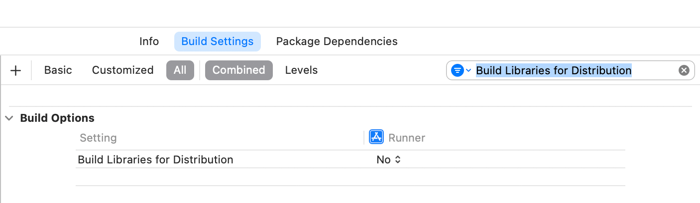

# Nextbillion Maps Flutter


## Native SDK upgrade

Version 4.0.0-beta.1 uses iOS Maps 2.3.3 and Android Maps 3.3.1. See the
[integration guide](doc/regional-offline.md) for Orbis, Regional Offline,
route trimming, lifecycle handling, and the Android 3.3.1 Orbis transition limitation.
See the [changelog](CHANGELOG.md) for release changes.

The example menu includes **Offline Maps & Route Playback**. Download a preset region,
open the playback tab, then disable the device's Wi-Fi and mobile data to test
the local track, vehicle marker and line trimming. The page also exposes pause,
resume, cancel, delete, style reload, map recreation and test-record export.
It uses SDK default storage and keeps map creation independent of offline setup.
This example replays preset coordinates; it does not calculate offline routes.

[](https://codecov.io/github/nextbillion-ai/nextbillion-maps-flutter)


## Prerequisites
* Access Key
* Android minSdkVersion 23+, compileSdkVersion 34+
* iOS 13+ (Flutter host; native SDK/package deployment target is 12.0)
* Flutter 3.41+
* In the build settings, locate "**Build Libraries for Distribution**" and ensure it is set to "**No**".
 

## Installation
### Dependency
Add the following dependency to your project pubspec.yaml file to use the NB Maps Flutter Plugin add the dependency to the pubspec.yaml:
```
dependencies:
  nb_maps_flutter: 4.0.0-beta.1
```

### iOS: Swift Package Manager (4.0.0-beta.1+)

Starting with version 4.0.0-beta.1, iOS integration is supported **only through Swift
Package Manager (SPM)**. CocoaPods support has been removed, including the plugin
Podspec and the native SDK fallback Podspec.

Enable SPM in your application's `pubspec.yaml`:

```yaml
flutter:
  config:
    enable-swift-package-manager: true
```

Then refresh dependencies and build:

```sh
flutter pub get
flutter build ios --simulator --debug
```

Flutter adds the plugin package and its native SDK dependency automatically.
The plugin pins `maps-native-distribution` to iOS Maps **2.3.3**. Use a Flutter SDK
**3.41+**, which generates the required FlutterFramework package; this setup is
validated with Flutter **3.44.0**. The
[example](example/pubspec.yaml) already enables SPM.

Native SDK storage paths are used automatically; no database destination setting
is required. Offline initialization and Preview preparation run independently of
normal map creation and style loading.

When upgrading an existing app, remove any explicit `NextBillionMap` Pod override
and migrate the map plugin's CocoaPods wiring to SPM. Apps can retain CocoaPods
for other dependencies. The example has removed its Pods build phases,
workspace references and xcconfig includes entirely.

### Import
Import the maps plugin in your code
```
import 'package:nb_maps_flutter/nb_maps_flutter.dart';
```

### Initialization
To run the Maps Flutter Plugin you will need to configure the NB Maps Token at the beginning of your flutter app using `NextBillion.initNextBillion(YOUR_ACCESS_KEY)`. 
```
 class _MapsDemoState extends State<MapsDemo> {
  @override
  void initState() {
    super.initState();
    NextBillion.initNextBillion(YOUR_ACCESS_KEY);
  }
}
```

## NBMap Widget
Create a NBMap Widget with initial camera position
```
NBMap(
      onMapCreated: onMapCreated,
      initialCameraPosition: const CameraPosition(
           target: LatLng(0.0, 0.0),
           zoom: 11.0,
  ),
)
```

## Run the example

From the repository root, run:

```sh
cd example
flutter pub get
flutter run --dart-define=ACCESS_KEY=YOUR_ACCESS_KEY
```

The example reads `ACCESS_KEY` at build time and has no default key. Pass the
same define to `flutter build` or `flutter drive` when using those commands.
Choose the map service on the home screen before opening a map. Regional Offline
requires TomTom.

## Regional Offline maps

Use the public `RegionalOffline` class from
`package:nb_maps_flutter/nb_maps_flutter.dart` to browse, download, and manage
catalog-based offline regions. The API works on iOS and Android and currently
requires **TomTom**. This release includes iOS Maps **2.3.3**, which fixes
independent snapshots of installed regions during regional offline fallback.

The native SDK manages the database location. `configure(mapsBaseUrl: ...)`
optionally selects a network CDN; it does not select a local storage directory.
Changing the CDN after initialization requires restarting the app.

### 1. Initialize TomTom and display the map

At app startup, initialize Flutter and await account initialization before
creating any maps. `MyApp` below is your application's root widget:

```dart
import 'package:flutter/material.dart';
import 'package:nb_maps_flutter/nb_maps_flutter.dart';

Future<void> main() async {
  WidgetsFlutterBinding.ensureInitialized();
  await NextBillion.initNextBillionWithTileServer(
    'YOUR_ACCESS_KEY',
    WellKnownTileServer.nbTomtom,
  );
  runApp(const MyApp());
}
```

Then display a normal `NBMap`. There is no separate offline-map widget:

```dart
NBMap(
  styleType: NBMapStyleType.bright,
  initialCameraPosition: const CameraPosition(
    target: LatLng(-33.8688, 151.2093),
    zoom: 13,
  ),
  onMapCreated: (controller) => mapController = controller,
)
```

Keep the provider fixed while maps are active. Start offline configuration from
the mounted page, for example after its first frame; show the map immediately.
Do not delay `runApp`, map creation, or style loading until configuration,
catalog requests, or Preview preparation finish. Report offline-operation errors
separately while keeping the map visible.

### 2. Configure the download page and observe readiness

Await configuration before using other offline methods or subscribing:

```dart
await RegionalOffline.configure();
final pageId = await RegionalOffline.beginDownloadPage();

final progressSubscription = RegionalOffline.downloadProgress.listen(
  (tasks) {
    for (final task in tasks) {
      debugPrint('${task.regionId}: ${task.state.name} ${task.percent}%');
    }
    // Refresh installed records when a task completes or disappears.
  },
  onError: (Object error) => debugPrint('Download event error: $error'),
);
final previewSubscription = RegionalOffline.previewBundleImportStatus.listen(
  (status) {
    debugPrint('Offline display resources ready: ${status.previewBundleReady}');
    // Also display waitingForNetwork and lastErrorMessage when relevant.
  },
  onError: (Object error) => debugPrint('Preview event error: $error'),
);
```

Preview is the SDK's shared preparation of resources used to display offline
maps. Its readiness is independent of a particular region's transfer progress.
Both streams provide an initial snapshot and subsequent updates. Current tasks
can disappear after completion/cancellation, so the task stream is not a
persistent list of installed regions.

Retain the page token and subscriptions until page cleanup. For widget lifecycle
handling, including leaving a page while initialization is pending, follow the
[complete download-page example](example/lib/regional_offline.dart).

### 3. Select and download a region while online

```dart
final catalog = await RegionalOffline.fetchRegionList(country: 'Australia');
// Present catalog to the user; it may be empty.
// Pass the chosen item's regionId to this handler:
Future<void> downloadSelectedRegion(int regionId) async {
  await RegionalOffline.downloadRegion(regionId);
}
```

`country` uses the full English name, such as `Australia` or `United States`;
omit it or pass a blank value for the full catalog. Use IDs returned by the
catalog or installed records. IDs must be integers from 0 through 2147483647,
inclusive. `fetchRegionDetail(regionId)` retrieves online package metadata.

**`downloadRegion()` completes when the task is accepted, not when installation
finishes.** Keep `clearBefore` at its default `false` for ordinary downloads and
resumption; `true` requests clearing the region's existing packages before a
fresh download. Observe task states, installed records, and Preview readiness:

```dart
Future<bool> isRegionReady(int regionId) async {
  final installed = await RegionalOffline.listInstalledRegions();
  final preview = await RegionalOffline.getPreviewBundleImportStatus();
  return installed.any((region) =>
          region.regionId == regionId && region.allTarsOk) &&
      preview.previewBundleReady;
}
```

This checks the SDK's installation/preparation flags, not every possible map
resource. A transfer percentage of 100 alone is insufficient. Coverage still
depends on the region, zoom, style, and required cached resources. On iOS,
`readinessIsBundleOnly` indicates that several resource-readiness flags derive
from the shared Preview Bundle rather than independent resource probes.

### 4. Reopen an installed region and use it offline

On subsequent launches, initialize TomTom and await `configure()` again for the
new process. Use these local queries without fetching the online catalog:

```dart
final installed = await RegionalOffline.listInstalledRegions();
// For an installed region selected by the user:
Future<RegionalOfflineRegionDetailResult> readSavedDetail(int regionId) =>
    RegionalOffline.loadOfflineDetail(regionId);
```

`loadOfflineDetail()` can return null detail/JSON when no metadata is saved.
`hasInstalledRegions()` is a quick presence check; it does not replace the
installation/readiness checks above. `queryRegions()` includes an online catalog
query and should not be used as a local-only startup requirement.

After map creation and offline configuration, optionally call
`await mapController.focusPreviewRegion(regionId)` to move the camera to an
installed region. A `false` result means usable coverage was unavailable or the
controller was disposed. You can also set the camera normally to a location
inside the downloaded coverage. The SDK loads resources from its local storage
as appropriate; the user does not need to download the region again each time
the map opens. `RegionalOffline.refreshEngine()` can request a resource refresh
and retry when returning to a map after installation or a network change.

For snapshots, use the existing controller API:

```dart
final imageBase64 = await mapController.takeSnapshot(
  SnapshotOptions(width: 320, height: 240, writeToDisk: false),
);
```

Use `writeToDisk: true` for a file result. Snapshots render a separate map and
do not capture the Flutter UI or on-screen annotation overlays. Even on iOS
2.3.3, missing resources/tiles can produce a blank or incomplete image; a
non-null result alone does not establish complete offline coverage.

### 5. Manage tasks and release the download page

Use `RegionalOffline.controlDownload(regionId, action)` with
`RegionalOfflineDownloadAction.pause`, `resume`, `cancel`, or `delete`.
Deletion removes local region packages. Command completion acknowledges the
action; refresh installed records and observe task events for its final state.

When leaving the download route, cancel both subscriptions and end its session:

```dart
await progressSubscription.cancel();
await previewSubscription.cancel();
await RegionalOffline.endDownloadPage(pageId);
```

In Flutter's synchronous `dispose()`, use the cleanup pattern in the example
rather than making `dispose()` async. Closing a page does not delete installed
regions or cancel process-wide downloads. Persistent Android background
downloads require a host foreground service and the native SDK's
`DownloadForegroundHook`; the Flutter plugin does not provide that service.

Catch `PlatformException` around awaited operations and provide stream `onError`
handlers. Useful operation codes include `NOT_INITIALIZED`,
`UNSUPPORTED_TILE_SERVER`, `CONFIGURATION_FAILED`, `INVALID_ARGUMENT`, and native
network/storage errors. Task progress can instead carry `errorMessage` or a
structured `error`; handle both channels.

The example menu provides **Regional Offline** for catalog/download management
and **Offline Maps & Route Playback** for map display, saved-track playback, and
offline checks. Replay uses preset coordinates and does not calculate offline
routes. See the [API entry point](lib/src/regional_offline.dart),
[data models](lib/src/regional_offline_models.dart),
[download example](example/lib/regional_offline.dart),
[playback example](example/lib/offline_navigation.dart), and
[detailed integration guide](doc/regional-offline.md).

The legacy `downloadOfflineRegion()` API downloads a bounds/zoom/style-based
offline pack. Its pack IDs and database import APIs are separate from these CDN
region IDs; `installOfflineMapTiles()` does not install regional CDN tar files.

## Location Component
### Configuration permissions
You need to grant location permission in order to use the location component of the NB Maps Flutter Plugin, declare the permission for both platforms:
### Android
Add the following permissions to the manifest:
```
<uses-permission android:name="android.permission.ACCESS_FINE_LOCATION" />
<uses-permission android:name="android.permission.ACCESS_COARSE_LOCATION" />
```

### iOS
Add the following to the Runner/Info.plist to explain why you need access to the location data:
```
 <key>NSLocationWhenInUseUsageDescription</key>
    <string>[Your explanation here]</string>
```

### Enable Location Tracking
* trackCameraPosition: true
* myLocationEnabled: true
* myLocationTrackingMode: MyLocationTrackingMode.Tracking

### Observe and Tracking User Location
* add the callback onUserLocationUpdated(UserLocation location)
* animate camera to user location within `onStyleLoadedCallback`
```
void _onMapCreated(NextbillionMapController controller) {
    this.controller = controller;
  }

_onUserLocationUpdate(UserLocation location) {
    currentLocation = location;
  }

_onStyleLoadedCallback() {
    if (currentLocation != null) {
      controller?.animateCamera(CameraUpdate.newLatLngZoom(currentLocation!.position, 14), duration: Duration(milliseconds: 400));
    }
  }

NBMap(
     onMapCreated: _onMapCreated,
     onStyleLoadedCallback: _onStyleLoadedCallback,
     initialCameraPosition: const CameraPosition(
            target: LatLng(0, 0),
            zoom: 14.0,
          ),
     trackCameraPosition: true,
     myLocationEnabled: true,
     myLocationTrackingMode: MyLocationTrackingMode.Tracking,
     onUserLocationUpdated: _onUserLocationUpdate,
)
```

## Annotations
To operate the mapview, you need to get the map controller in the `onMapReady(NextbillionMapController controller) callback`.
### Symbol Annotation
The Symbol annotation adds a symbol to the map. It is configured by the specified custom SymbolOptions. If you need to add an image symbol, you need to add the image source to the map style.
#### Add image source
```
final ByteData bytes = await rootBundle.load("assets/image.png");
final Uint8List list = bytes.buffer.asUint8List();
await controller?.addImage("ic_marker", list);
```
```
var symbol = controller.addSymbol(
      SymbolOptions(
          geometry: LatLng(-33.894372606072309, 151.17576679759523),
          iconImage: "ic_marker",
          iconSize: 2),
    );

//remove annotation
controller!.removeSymbol(symbol);

//update annotation
controller!.updateSymbol(symbol, updatedOptions)
```
#### Line Annotation
The Line annotation adds a line to the map. It is configured by the specified custom LineOptions.
```
var line = controller.addLine(
      LineOptions(
        geometry: [
          LatLng(-33.874867744475786, 151.170627211986584),
          LatLng(-33.881979408447314, 151.171361438502117),
          LatLng(-33.887058805548882, 151.175032571079726),
        ],
        lineColor: "#0000FF",
        lineWidth: 20,
      ),
    );

//remove annotation
controller!.removeLine(line);

//update annotation
controller!.updateLine(line, updatedOptions)
```
#### Fill Annotation
The Fill annotation adds a fill to the map. It is configured using the specified custom FillOptions.
```
var fill = controller!.addFill(
      FillOptions(
        geometry: [
          [
            LatLng(-33.901517742631846, 151.178099204457737),
            LatLng(-33.872845324482071, 151.179025547977773),
            LatLng(-33.868230472039514, 151.147000529140399),
            LatLng(-33.883172899638311, 151.150838238009328),
            LatLng(-33.901517742631846, 151.178099204457737),
          ],
        ],
        fillColor: "#FF0000",
        fillOutlineColor: "#000000",
      ),
    )

//remove annotation
controller!.removeFill(fill);

//update annotation
controller!.updateFill(fill, updatedOptions)
```
#### Circle Annotation
The Circle annotation adds a circle to the map. It is configured using the specified custom CircleOptions.
```
var addCircle = controller!.addCircle(
      CircleOptions(
        geometry: LatLng(-33.894372606072309, 151.17576679759523),
        circleStrokeColor: "#00FF00",
        circleStrokeWidth: 2,
        circleRadius: 30,
      ),
    );
```
#### Annotation onTap Callbacks
The following code snippet shows how to add Callbacks to receive tap events, and how to place annotations on this map, and how to remove these callbacks in dispose() function.
```
void _onMapCreated(NextbillionMapController controller) {
    this.controller = controller;
    controller.onFillTapped.add(_onFillTapped);
    controller.onCircleTapped.add(_onCircleTapped);
    controller.onLineTapped.add(_onLineTapped);
    controller.onSymbolTapped.add(_onSymbolTapped);
  }

 @override
  void dispose() {
    controller.onFillTapped.remove(_onFillTapped);
    controller.onCircleTapped.remove(_onCircleTapped);
    controller.onLineTapped.remove(_onLineTapped);
    controller.onSymbolTapped.remove(_onSymbolTapped);
    super.dispose();
  }
```

## Selecting a map service and changing styles

Choose the native service before creating any maps, then keep it fixed for the
process. The available services are `nbTomtom`, `nbMapTiler`, and `nbTomtomOrbis`:

```dart
await NextBillion.initNextBillionWithTileServer(
  accessKey,
  WellKnownTileServer.nbMapTiler,
);
// Create NBMap after initialization.
```

Within that service, change an existing map's predefined style using the enum:

```dart
await controller.setStyleType(NBMapStyleType.night);
```

Styles are `bright`, `night`, and `satellite`. Wait for
`onStyleLoadedCallback` before restoring custom layers and annotations. Flutter
does not construct preset style URLs. A callback alone does not confirm that
every map resource finished loading.

Changing services on an existing MapView is outside this release's supported
scope. The global `NextBillion.switchWellKnownTileServer(...)` and controller
`switchTileServer(...)` APIs remain for compatibility; their acceptance does not
guarantee that an existing map can load the new service. iOS Maps 2.3.2 can retain
the previous resource configuration. Recreating a Flutter map alone does not
guarantee that process-wide SDK resource pools are reset. Test each service in
a fresh app process, selecting it before map creation.

Android Maps 3.3.1 still rejects Orbis selection during or after Regional Offline
setup with `SDK_UPDATE_REQUIRED`; this protective check remains in place.
In the example, choose the service on the home screen before opening a map.
The **Map Style Switch** page displays that fixed service and changes styles only.

### Custom style input on iOS

`NBMap.styleString` accepts style URLs, local file URLs, and Flutter asset paths.
Rebuild `NBMap` with a new value to update custom style configuration. The
`NextbillionMapController.setStyleString()` method was removed in 4.0.0-beta.1; use
`controller.setStyleType()` for predefined themes. Inline JSON strings are supported on Android.
On iOS, inline JSON is rejected with `PlatformException` code
`UNSUPPORTED_STYLE_JSON`, including initial widget options and later updates.
Write custom JSON to a local file and pass its `file://` URL on iOS.

## Camera
Defines a camera move, supports absolute moves as well as moving relatively to a specified position.
### CameraUpdate
A Camera update moves the camera to the specified CameraPosition with the camera's [target] geographical location, its [zoom] level, [tilt] angle and [bearing].
```
CameraUpdate.newCameraPosition(
       const CameraPosition(
              bearing: 270.0,
              target: LatLng(51.5160895, -0.1294527),
              tilt: 30.0,
              zoom: 17.0,
        ),
 )
controller.animateCamera(cameraUpdate)
```
The following code snippet shows how to move the camera target to a specified geographical location.
```
CameraUpdate.newLatLng(const LatLng(56.1725505, 10.1850512))
```
### Move Camera
The animateCamera() function starts an animated change of the map camera position
```
controller.animateCamera(cameraUpdate, duration)
```
The moveCamera function will move the camera quickly, which can be visually jarring for a user. In real usage we should strongly consider using the animateCamera() methods instead of moveCamera() because it's less abrupt.
```
controller.moveCamera(cameraUpdate)
```
### More
* scrollBy()
* zoomBy()
* zoomIn()
* zoomOut()
* zoomTo(double zoom)
* bearingTo(double bearing)
* tiltTo(double tilt)
